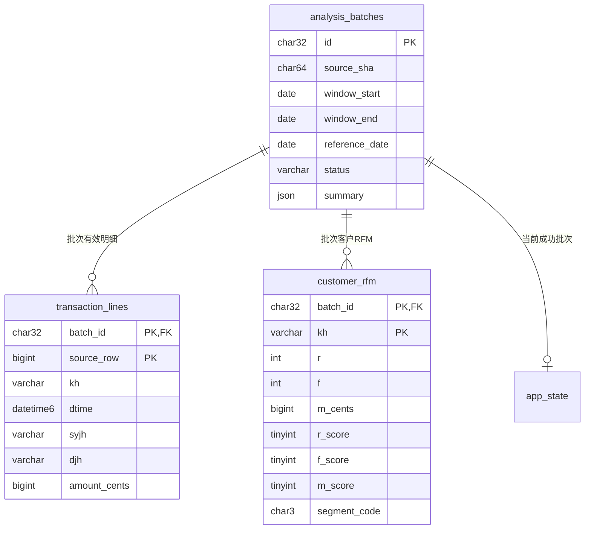

# 数据库与接口

使用真实MySQL 8.4，项目内实例绑定127.0.0.1:3307，未替换为SQLite。DDL在schema.sql，数据库和独立应用账户由scripts/setup_mysql.py创建。应用账户仅有项目库SELECT/INSERT/UPDATE/DELETE权限；root密码仅保存在runtime/mysql-admin.env，连接配置在.env，均不提交。

## 数据关系

- analysis_batches：原文件路径、显示名、SHA-256、窗口、基准日、规则版本、任务状态、进度、错误、时间、耗时、实际摘要JSON。
- transaction_lines：有效明细，保留12原字段和原行号，完整购买时间存DATETIME(6)，je原文本与amount_cents并存。商品编码最长实际达到269字符，使用TEXT保留，不截断。
- customer_rfm：每批每客户一行，存R/F/M、明细数、最近购买、评分、群体标签。
- app_state：单行指向当前成功批次。更新发生于成功事务中。
- 原始CSV和上传文件保留在文件系统，排除记录按批次CSV留档，没有为每次分析重复把全部189万原始行写入数据库。

索引覆盖批次/客户/时间、批次/分群/金额；所有用户输入通过参数绑定，排序字段用白名单。导出使用相同筛选，CSV通过服务端游标流式生成。

## HTTP接口

默认地址 http://127.0.0.1:5000。JSON错误格式`{"error":"中文说明"}`，成功响应使用实际计算结果。GET接口可传batch_id固定成功批次；未指定时使用当前成功批次。

| 方法 | 路径 | 用途与主要参数 |
|---|---|---|
| GET | / | 中文工作台 |
| GET | /api/health | 真实MySQL连接及版本 |
| GET | /api/summary | 批次摘要、RFM阈值、分群、质量报告 |
| GET | /api/sales | start/end日期筛选，返回卡片、月度、前10商品/柜组 |
| GET | /api/customers | kh部分标识、segment三位编码、sort=m/f/r/kh、page、page_size≤100 |
| GET | /api/customers/客户标识 | 客户RFM、分页有效明细，page默认1、每页20 |
| GET | /api/export | 同客户筛选与排序，format=csv/xlsx，全量匹配结果 |
| GET | /api/batches | 最近50条批次与当前批次ID |
| GET | /api/batches/批次ID | 后台任务状态，不暴露服务器文件路径 |
| POST | /api/import | JSON内置source=builtin，或source_batch=已有批次；multipart file上传 |
| POST | /api/batches/批次ID/activate | 切换到成功批次 |
| GET | /api/batches/批次ID/artifacts/quality | 下载质量与计算报告JSON |
| GET | /api/batches/批次ID/artifacts/cleaned | 下载有效明细CSV |
| GET | /api/batches/批次ID/artifacts/excluded | 下载排除记录CSV |

导入可传start/end/reference，默认2017-01-01/2018-01-01/2018-01-01。新任务返回202及id；重复成功任务返回200、reused=true。错误分别使用400（参数或格式）、403（跨站写入）、404（不存在）、409（已有分析任务）、413（文件超限）、503（数据库连接）。后台分析错误通过状态接口的failed/error显示，完成前不得显示成功。

应用为本机演示，不提供登录。服务只绑定本机，浏览器跨站写入被拒绝。不要将本地数据库和应用直接开放到公网。
